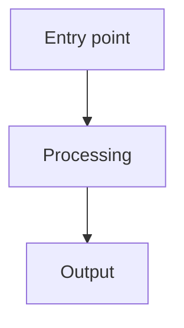

# Color palette

Load this file when the user explicitly requests custom node styling or asks
about `classDef`, colors, or fill/stroke values.

## Publication mode warning

For LaTeX figures, academic papers, or any output where diagram source is
passed through a third-party exporter, **avoid custom `classDef` rules**. Many
exporters ignore or misrender CSS overrides, and the default Mermaid theme
produces cleaner output for those contexts.

## Grayscale harmony palette

Use this palette by default if not requested to use colors by user:

```mermaid
classDef darkGrey fill:#424242,stroke:#212121,color:#fff,rx:10,ry:10
classDef midGrey fill:#757575,stroke:#424242,color:#fff,rx:10,ry:10
classDef lightGrey fill:#BDBDBD,stroke:#757575,color:#333,rx:10,ry:10
```

The verbatim template is also available in `assets/grayscale-classes.mmd` for
copy-paste into diagram source.

| Class | Fill | Stroke | Text | Use for |
|---|---|---|---|---|
| `darkGrey` | `#424242` | `#212121` | white | Primary / emphasis nodes |
| `midGrey` | `#757575` | `#424242` | white | Secondary nodes |
| `lightGrey` | `#BDBDBD` | `#757575` | dark | Tertiary / background nodes |

## Applying classes

Use the `:::className` suffix directly on node declarations:



Do not use `class NodeId className` on a separate line. The `:::` suffix keeps
class assignment co-located with the node and is less error prone.
