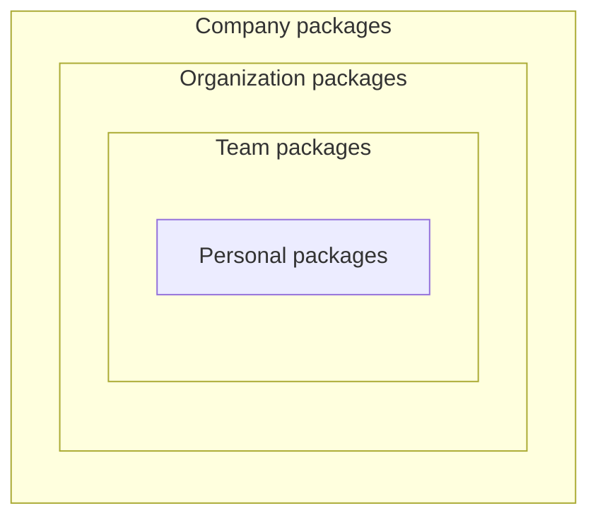

# Diagram types

Collection of frequently used diagrams and the preferences regarding them.

### Box diagram

Use this diagram when user asks for a box diagram or visualising the relation between some abstractions in a situation where it is important to show wich object is part of wich one.

#### Example

