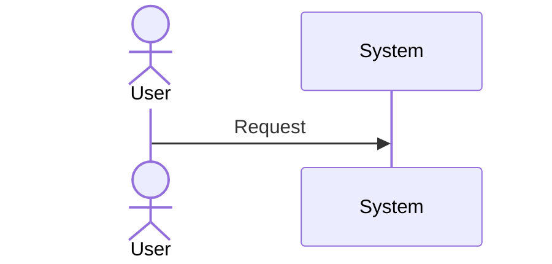
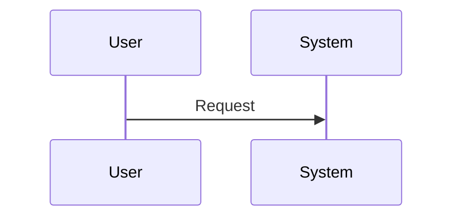
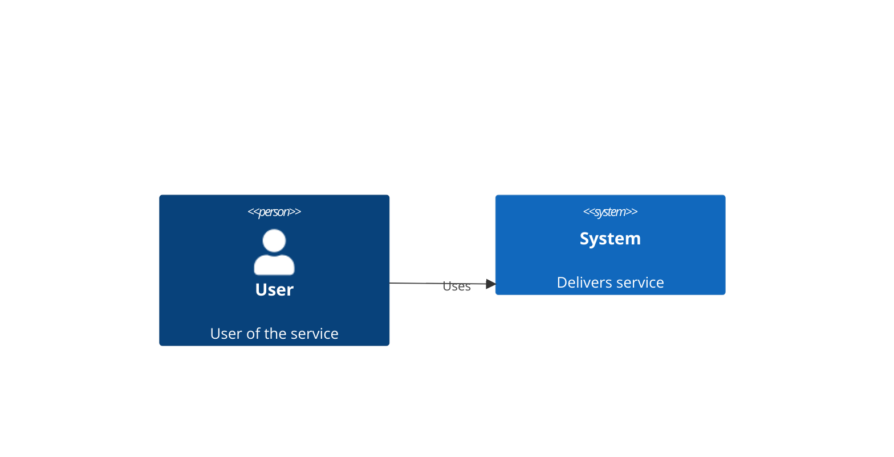
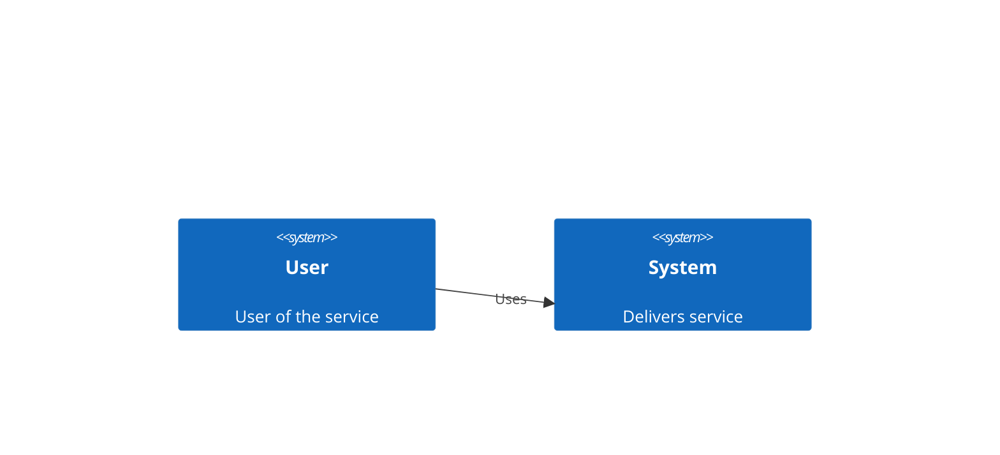

# Shape preferences

### Drawing humans

Use a stickman or person representation, not a generic block

#### Sequence diagram

##### positive example

##### negative example

#### C4 diagram

##### positive example

##### negative example
