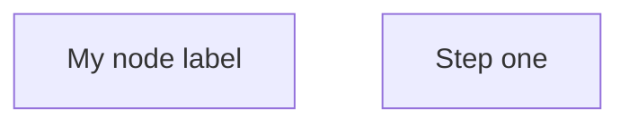

# Syntax rules

## Multi word labels

Always use square brackets with double quotes for any label containing a space
or special character:



Single word labels may omit the quotes, but wrapping all labels consistently
avoids surprises when labels are later extended.

## Forbidden characters

The `&` character is parsed as an HTML entity inside Mermaid source and
produces rendering errors or unexpected output. Never use it in:

- Node labels
- Edge descriptions
- Subgraph titles
- Captions

Write "and" instead in all cases.

## Parentheses and brackets in labels

Do not embed parenthesised or bracketed descriptions inside a node label:

- Incorrect: `A["User request (auth flow)"]`
- Correct: `A["User request"]`

## Special characters in edge descriptions

Edge labels follow the same rules. Wrap them in double quotes when they contain
spaces:

```mermaid
A -->|"sends request"| B
```
